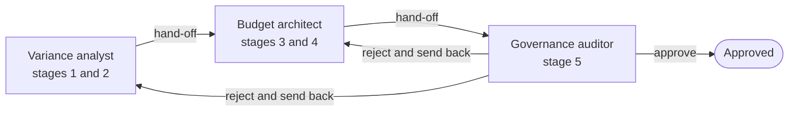

# multi-agent-fpa-workspace

Three agents on the Claude Agent SDK build a next-year operating budget in Excel from 24 months of cost-center actuals. A variance analyst measures the trends, a budget architect builds the workbook and applies the cut rules, and a governance auditor checks the result and either approves it or sends the work back. Python code outside the model decides what each agent may run, read and write, refuses any hand-off that states a number no tool returned, and refuses an approval unless the audit script passed. Every figure comes from a script or an Excel formula; the agents decide what to run and check, and write the hand-offs.

The data is synthetic: 36 invented cost centers, 24 months and 4 planted one-off spikes, generated by `src/prepare_data.py`. Amounts are in NIU (index units), so no real currency appears.

## See it work without an API key

Two real agent runs are recorded in `demo/`. Read them as transcripts, or replay them against the current code:

```bash
git clone https://github.com/Siyuan-Zhu/multi-agent-fpa-workspace.git
cd multi-agent-fpa-workspace
python -m venv .venv && source .venv/bin/activate
pip install -r requirements.txt
python src/run_agents.py --replay demo/rejected_run
# Recorded outcome: approved. Replayed outcome: approved.
```

- [`demo/clean_run/transcript.md`](demo/clean_run/transcript.md): approved on the first pass, in 3 agent runs.
- [`demo/rejected_run/transcript.md`](demo/rejected_run/transcript.md): a locked row is altered before the audit; the auditor finds it and sends the work back, and the second audit passes. 5 agent runs.

## How the agents work



`src/run_agents.py` starts the run. The coordinator (`src/agents/coordinator.py`) runs the agents in a fixed order and gives each one the earlier hand-offs. When the auditor rejects, it names the agent that must redo its stages, and work runs forward again from that agent. The coordinator allows two send-backs and stops the run at a third rejection. It also stops if an agent reports itself blocked or finishes without handing off.

Each agent is its own SDK session on Sonnet (`src/agents/sdk_runner.py`):

- Its system prompt is three files, loaded in order: `workspace/GLOBAL_CONTEXT.md` (rules that always apply), `workspace/WORKSPACE_CONTEXT.md` (this budget cycle and its divisions) and its role contract in `workspace/agents/`.
- Its tools come from its entry in `config/workspace_governance.json`: one tool per script it may run, a `read_file` limited to its read and write scopes plus the shared context files, and a tool to hand off. The SDK's built-in tools, such as the shell and file editing, are switched off, and the runner raises an error if the session offers any tool outside that list.

| Agent | Stages | Scripts it can run | Can read the workbook |
| :--- | :--- | :--- | :--- |
| Variance analyst | 1 and 2 | `prepare_data.py`, `build_trends.py` | No |
| Budget architect | 3 and 4 | `build_rough_budget.py`, `cut_review_rules.py` | Yes |
| Governance auditor | 5 | `verify_governance.py` | Yes |

Three checks run in code, outside the model, in `src/agents/toolbox.py`:

| Check | What it does |
| :--- | :--- |
| Write scope | Hashes `data/` and `output/` before and after every script call. If a file outside the agent's write scopes changed, the tool result says so, and the coordinator stops the run when that agent finishes. |
| Citations | Refuses a hand-off or verdict that states a figure no tool returned, so agents have to copy numbers from script output. |
| Approval | Refuses an approval unless `verify_governance.py` passed in the auditor's own session. |

### The rejected run

After the architect handed off, the coordinator changed one locked row on purpose: CC-208's final budget, from 362.10 to 367.10 NIU, standing in for an unsigned hand edit. The audit failed ADR-0004. The auditor compared the workbook with the proof file, named CC-208 as the row that no longer matched, and sent the work back to the architect. The architect re-ran stages 3 and 4, which rewrote the row from the signed overrides, and the second audit passed.

The citation check also fired in that run. The auditor's first verdict stated a 5.0 NIU difference it had worked out itself, which no tool had returned. The tool refused it, and the auditor resubmitted without the number.

The clean run cost about $0.12 at Sonnet API prices and the rejected run about $0.35.

Each `demo/` folder has `transcript.md` to read, `transcript.jsonl` with every event, `summary.json`, and the run's `outputs/`. The tests replay both recordings: each recorded tool call is sent again to the current code and must return the same output, and the hand-offs must lead the coordinator to the same outcome. The model's text is not replayed, so a replay needs no key.

## The problem

You are building the FY2027 budget from 24 months of actuals. Four things go wrong if you do it by hand in a spreadsheet:

1. One-off spikes distort the trend. A one-time rack consolidation fee makes one line look like it grew 110% when its recurring growth is 4.5%. If you cut by growth rate, you cut the wrong lines.
2. Reserve money gets swept. A designated R&D reserve sits next to the operating lines, and a blanket cut across all lines takes money the reserve was set aside for.
3. Some lines cannot be cut. Contracts and compliance costs are fixed. Payroll goes through a headcount discussion, not a percentage cut.
4. Re-running overwrites human work. The controller adjusts seven lines by hand. Then a driver changes and you recalculate. The manual adjustments are gone, and nobody can show they are intact.

## The pipeline

Five scripts run in order. The agents call them through tools; `src/run_all.py` runs all five with no model.

| Stage | Script | What it does |
| :--- | :--- | :--- |
| 1 | `src/prepare_data.py` | Generates the actuals. Splits each month into recurring and one-off amounts and writes the spikes to `excluded_one_off_items.csv`. |
| 2 | `src/build_trends.py` | Compares the last 12 months (TTM) with the 12 before (P12M) on recurring amounts only, and gives each line a year-over-year growth rate. |
| 3 | `src/build_rough_budget.py` | Builds `output/FY2027_Rolling_Budget_Model.xlsx`: TTM recurring spend times a growth driver per expense category. Roll-ups are live Excel formulas (`SUM`, `SUMIF`). |
| 4 | `src/cut_review_rules.py` | Applies the cut rules, writes in the controller's seven manual locks, then re-runs the model with a +1.50 point change to the growth driver and records the proof. |
| 5 | `src/verify_governance.py` | Reads the workbook back, checks every rule and writes `governance_audit_report.json`. |

### The four business rules

Each rule is a short decision record (ADR) in `decisions/`.

| ADR | Rule |
| :--- | :--- |
| [0001](decisions/0001-ttm-seasonal-baseline-and-one-off-exclusion.md) | Remove one-off items before measuring growth, and compare full 12-month windows so seasonality is in both periods. |
| [0002](decisions/0002-ring-fenced-designated-reserve-transfers.md) | The R&D reserve is its own pool. No automated cut touches it and no money moves between the reserve and operating lines. |
| [0003](decisions/0003-tiered-opex-compression-and-protected-lines.md) | Contract and compliance lines are never cut. Personnel goes to a headcount scenario. Discretionary lines are cut by growth: 12% if growth is 8% or more, 6.5% from 3% to 8%, 3% below that. |
| [0004](decisions/0004-non-destructive-human-override-preservation.md) | A row the controller locked is never rewritten. A re-run changes only unlocked rows. |

## Method

- Recurring baseline. Growth is measured on recurring amounts only, because a spike in one window makes a normal line look like an outlier.
- Trailing 12 months against the prior 12. Two full years put each seasonal pattern (flat, Q2/Q4, Q4-heavy) in both windows, so growth is not a seasonal artefact.
- Growth driver by category. The rough budget grows each line by a rate tied to its own growth, clipped to a range per category. Payroll gets a flat rate.
- Live formulas. Totals in the workbook are Excel formulas, so a reviewer can click a cell and see the arithmetic.
- Hashes for the lock proof. For every row, stage 4 computes a SHA-256 hash over the fields a human controls: cost center, flag, adjustment %, final budget, disposition and commentary. It hashes all 36 rows after the locks go in, re-runs the model, and hashes again. A locked row passes only if the two hashes are identical.

## Findings

From a fresh run of `python src/run_all.py`:

| Result | Value |
| :--- | ---: |
| TTM gross spend | 12,780.04 NIU |
| One-off spikes removed (4 events, trailing 12 months) | 315.00 NIU |
| TTM recurring baseline | 12,465.04 NIU |
| Portfolio growth, gross vs recurring | 7.21% vs 5.40% |
| Discretionary lines that would land in the wrong cut tier without ADR-0001 | 4 of 13 |
| FY2027 rough budget after the re-run | 13,099.26 NIU |
| FY2027 final budget | 12,877.22 NIU (-222.04 NIU) |
| Operating pool, final | 10,149.29 NIU |
| Reserve pool, final | 2,727.93 NIU |
| Cross-fund transfers | 0.00 NIU |
| Dispositions across 36 lines | 10 protected, 4 to headcount, 10 discretionary cuts, 6 reserve (5 ring-fenced, 1 locked), 6 locked operating |
| Locked rows unchanged after the re-run | 7 of 7 (identical hashes, 0.00 NIU change) |
| Unlocked rows recalculated | 29 of 29 |

Left in, the spikes push three lines into the 12% cut tier when their recurring growth is under 8%, and one line, whose spike fell in the prior year, shows a 25% decline when its recurring growth is 11.5%. Removing them corrects four of the 13 discretionary lines.

Of the 222.04 NIU reduction, 141.40 NIU comes from the 10 discretionary cuts (4 at 12%, 3 at 6.5%, 3 at 3%) and 80.64 NIU from the controller's seven locked adjustments. The automated rules left the other 19 unlocked lines unchanged. The reserve ends 0.38 NIU below its rough figure, and all of that is the controller's own lock on CC-903. The per-row hash proof is in [`docs/rerun_preservation_proof.json`](docs/rerun_preservation_proof.json); each locked row lists its before and after hash, and they match.

## Scope and limits

- The data is synthetic. The findings show the rules working on a planted test case, and say nothing about any real company's budget.
- `src/run_all.py` calls no model. The agents call the same scripts through tools, so every figure still comes from a script or a cell formula.
- The coordinator runs a fixed order. The agents cannot reorder the stages, skip one or add one.
- The coordinator put the fault in the rejected run on purpose, to show the send-back path.
- The citation check compares decimal figures by value with everything the agent has seen: its task, the files it read and its tool output. It refuses a decimal that appears in none of them. It does not check whole numbers, it misses a worked-out figure that happens to appear somewhere in that material, and it cannot tell whether a copied number is used in the right sentence.
- Two recorded runs are not an evaluation. The agents' wording changes from run to run, so the tests check only the tool outputs and the guards.
- `src/verify_governance.py` uses the same domain module and policy file as the build stages. It is a regression check on the rules, not an independent audit.
- The re-run tests one scenario, a +1.50 point change to the growth driver. The thresholds and cut percentages are policy settings in `config/workspace_governance.json`.
- The output is an Excel workbook and JSON files. There is no interface.

## Run it

Python 3.11 or later.

```bash
python -m venv .venv && source .venv/bin/activate
pip install -r requirements.txt pytest "ruff>=0.6,<1"
python src/run_all.py      # the pipeline without agents; rebuilds data/ and output/ from scratch
pytest -q                  # 20 tests, including the replays; no API key needed
ruff check .

# Live agent runs need a Claude Code login or ANTHROPIC_API_KEY
pip install -r requirements-agents.txt
python src/run_agents.py --record demo/clean_run
python src/run_agents.py --tamper --record demo/rejected_run   # edits CC-208 after the architect hands off
python src/run_agents.py --replay demo/rejected_run            # no key: re-issues the recorded tool calls
```

CI (`.github/workflows/ci.yml`) runs `ruff check .`, `python src/run_all.py` and `pytest -q` on Python 3.11, 3.12 and 3.13. It does not install the SDK or call a model.

## Working in this repo

Before changing code, read [AGENTS.md](AGENTS.md): the checks to run before a commit, which files are generated or recorded, and what to ask about first.
